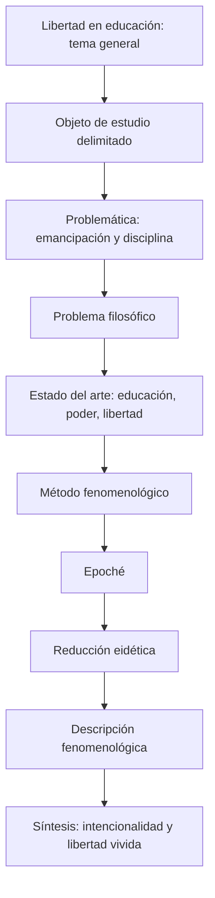

# Métodos de Investigación Filosófica — 14 de octubre de 2026
## De la libertad como concepto a la libertad vivida

> [!abstract] Idea central
> **Entender un concepto no equivale a comprender el fenómeno.** La sesión toma la libertad en el ámbito educativo como objeto de investigación y muestra cómo estudiarla en tanto **experiencia vivida**, no sólo como definición jurídica, ideal pedagógico o abstracción.

**Página de la clase:** [PHILOSOPHIA — 14 de octubre](https://kychan00.github.io/philosophia/#/semestre/5/metodos-de-investigacion/clase/14-octubre)

**Enlaces del vault:** [[Métodos de Investigación Filosófica]] · [[Fenomenología]] · [[Libertad]] · [[Filosofía de la educación]] · [[Estado del arte]]

## 1. Itinerario de investigación

### Tema y objeto

- **Tema general:** la libertad en la filosofía de la educación.
- **Objeto de estudio:** vivencias de **autodeterminación, elección y resistencia** del estudiante en el espacio físico y simbólico del aula tradicional; el ejemplo contempla niveles de secundaria a preparatoria.
- **Delimitación filosófica:** no reducir la libertad a disposiciones normativas ni a definiciones de derechos y obligaciones; preguntar cómo aparece en las relaciones y experiencias del sujeto escolar.

## 2. Problemática: la escuela entre emancipación y disciplina

La sesión presenta una tensión estructural entre dos funciones atribuidas a la institución escolar:

| Ideal emancipador | Lógica disciplinaria |
| --- | --- |
| Educar para la libertad y la crítica. | Ajustar cuerpos y mentes a instituciones y sistemas productivos. |
| Apropiación del conocimiento y autonomía. | Horarios rígidos, asistencia, evaluaciones, vigilancia, estandarización. |
| El estudiante como sujeto activo. | El estudiante como individuo que debe adaptarse. |

La clase plantea que los discursos de aprendizaje autónomo pueden coexistir con arquitecturas, procedimientos administrativos y prácticas punitivas que restringen la autodeterminación.

> [!question] Problema filosófico formulado en la sesión
> ¿Cómo experimenta y significa el estudiante su libertad —su autonomía y agencia— en un entorno escolarizado que normaliza la restricción corporal, la vigilancia constante y la estandarización del pensamiento?

Esta pregunta condensa la problemática: **cómo puede vivirse la libertad dentro de una institución que simultáneamente forma y disciplina**.

## 3. Estado del arte: tres autores y tres ejes

La búsqueda bibliográfica debe realizarse **después** de precisar el objeto y el problema. Tres ejes organizan la revisión: **educación, poder y libertad**.

### Paulo Freire — educación y liberación

- Contraste entre **educación bancaria** (alumno como receptor de depósitos de información) y **educación liberadora**.
- La formación crítica reclama **diálogo, concientización y transformación de la realidad**.
- La libertad no queda reducida al pensamiento aislado: es **praxis**, articulación de reflexión y acción.

### Michel Foucault — poder y disciplina

- La organización escolar se analiza por su distribución del **espacio y del tiempo**.
- Banca, vigilancia, rutina, examen y horario pueden actuar como técnicas disciplinarias.
- La noción de **cuerpos dóciles** da un marco para indagar cómo las instituciones modelan prácticas y conductas.

### Jean-Jacques Rousseau — libertad y formación

- Desde *Emilio o De la educación*, la clase considera la libertad natural y los efectos de la educación sobre la experiencia infantil.
- La tarea del educador no se identifica necesariamente con **imponer su voluntad**: puede generar condiciones que permitan aprender a partir de la relación con las cosas y sus consecuencias.
- Se contrasta la figura del maestro que ordena con la del **facilitador**.

**Matriz orientadora de búsquedas:** educación ↔ libertad; educación ↔ poder; poder ↔ libertad. El estado del arte debe preguntar qué se ha investigado en estas conexiones, desde qué perspectivas y qué espacio de investigación permanece.

## 4. Método fenomenológico: del concepto a la vivencia

La clase distingue entre:

- **Entender:** saber definir o ubicar conceptualmente un fenómeno.
- **Comprender:** examinar **cómo se vive** y qué sentido adquiere en la experiencia concreta.

Para trabajar la libertad escolar se expone una secuencia didáctica de cuatro movimientos:

### I. Epoché — suspensión del juicio

Consiste en **poner entre paréntesis** las definiciones legales, reglamentos escolares, planes de estudio y teorías pedagógicas previamente asumidas. La suspensión no niega que existan: impide que anticipen lo que debe encontrarse.

**Aplicación:** atender la experiencia consciente e inmediata del estudiante a lo largo de la jornada, sin imponer desde el comienzo una interpretación administrativa o moral.

### II. Reducción eidética — búsqueda de lo invariante

Se pregunta **qué permanece** de la experiencia de libertad cuando imaginamos variaciones en sus condiciones: exámenes, materias, currículo, controles o distribución institucional del tiempo.

**Hipótesis ilustrativa de la clase:** la libertad escolar no reside simplemente en el currículo, sino en cierta capacidad del sujeto para orientar su cuerpo y su pensamiento.

> [!note] Precisión metodológica
> La reducción eidética se trabaja aquí como procedimiento de variación para buscar un núcleo invariante, **no** como una demostración empírica ya completada. La formulación sobre la libertad corporal y mental corresponde al ejemplo explicativo del profesor.

### III. Descripción fenomenológica — corporalidad y expresión

La experiencia del estudiante se manifiesta corporalmente: **postura, miradas, silencio, dolor de espalda, aburrimiento, susurros, dibujos en el margen y pequeños desplazamientos de la atención**.

El ejercicio consiste en describir con cuidado lo que aparece, evitando inferencias prematuras: **dibujar no prueba por sí solo desinterés**; una mirada hacia la ventana tampoco prueba falta de comprensión.

### IV. Síntesis e intencionalidad — dirección de la conciencia

La síntesis vuelve sobre la **intencionalidad**: hacia qué se dirige la conciencia y de qué forma el estudiante se apropia de su pensamiento. Incluso en una situación corporalmente restringida puede aparecer una actividad reflexiva que excede las demandas inmediatas del profesor.

**Conclusión presentada en la sesión:** la libertad educativa no equivale necesariamente a la ausencia de reglas; puede manifestarse como **apropiación intencional del propio pensamiento** en un entorno que busca dirigir la conducta y la atención.

## 5. Ejemplo desarrollado: dibujar o mirar hacia la ventana

El profesor utiliza un estudiante que dibuja en su cuaderno o desvía la mirada durante la clase. El ejemplo permite comparar dos perspectivas:

| Juicio precipitado | Registro fenomenológico propuesto |
| --- | --- |
| «Está distraído». | Describe que dibuja, mira a otro punto o cambia de postura. |
| «No le interesa la materia». | Pregunta por el sentido de ese gesto para el sujeto. |
| «No presta atención». | Considera si aparece una reflexión, una decisión o un ejercicio de autonomía. |

No se afirma que cualquier distracción sea libertad o pensamiento crítico. El punto metodológico es **evitar dar por resuelto el sentido del gesto antes de describirlo y comprenderlo**.

## 6. Universidad, humanidades y función social del conocimiento

En el tramo final se reflexiona sobre la diferencia entre **educación básica y formación universitaria**, especialmente en las humanidades. Se reivindica la práctica de **argumentar, contraargumentar y examinar razones**, frente a la reducción de los aprendizajes a reactivos uniformes o resultados estandarizados.

### Justo Sierra

Se recupera y comenta un pasaje relacionado con el proyecto de universidad y la formación nacional. La lectura pone en tensión la universidad como institución que **produce e intelectualiza el saber** y el riesgo de crear una élite aislada de la vida social. El conocimiento debe mantenerse en relación con su contexto y su realidad.

**Criterio de fidelidad:** el archivo original presenta varias deformaciones de reconocimiento de voz durante la lectura del discurso de Sierra. Por eso estas notas **sintetizan las ideas discutidas** y no reproducen como cita literal un pasaje cuya redacción no puede establecerse con certeza.

## 7. Estructura mínima del protocolo fenomenológico

1. **Construir el objeto de estudio:** delimitar concepto, sujetos, ámbito y fenómeno.
2. **Desarrollar la problemática:** mostrar la tensión o contradicción relevante.
3. **Formular el problema filosófico:** extraer la pregunta nuclear.
4. **Diseñar el estado del arte:** definir autores, ejes y términos de búsqueda.
5. **Indicar el procedimiento:** epoché → reducción eidética → descripción → síntesis/intencionalidad.
6. **Explicar el alcance:** señalar qué vivencias se examinarán y qué no podrá inferirse sin investigación adicional.

> [!important] Criterio de trabajo
> Una investigación filosófica necesita claridad sobre **qué** estudiará, **desde dónde** lo abordará y **cómo** procederá. El estado del arte no es una colección aleatoria de nombres: se organiza a partir de problemas y relaciones conceptuales.

## 8. Continuidad del curso

- Se menciona el posible trabajo posterior sobre **hermenéutica analógica de Mauricio Beuchot**, hacia mediados de noviembre, **sin fecha exacta ni responsable inequívocamente confirmados** en el texto suministrado.
- Se alude también a continuidad de lecturas y exposiciones; no se registra una entrega con fecha segura.
- [[Métodos de Investigación Filosófica]]: relacionar esta sesión con las notas previas sobre tema, objeto, problemática, problema y estado del arte.

## 9. Criterio editorial y trazabilidad

Estas son **notas de clase organizadas para estudio**, no una reproducción dialogada. Se preservan como **explicación de la sesión** las posiciones atribuidas al profesor; la propuesta de libertad como invariante se reconoce como **resultado ilustrativo**, no verificación universal. Los nombres propios y conceptos identificables se normalizan en su grafía. Los fragmentos ambiguos no se convierten en citas ni instrucciones de entrega inventadas. La conversación informal posterior al cierre académico queda fuera del documento.

**Referencia interna de estilo:** [[Regla de oro - Fidelidad radical a las fuentes]] — primero fidelidad, después claridad, después diseño.
